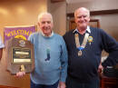

Nick has served Bodmin as Town Crier for the last **Forty, yes Forty years**. During that time he has represented our town in many competitions both home & abroad & made many friends.

Nick has always supported Lions & Town events, with his trusty bell & smiling face he's made any necessary announcements.

He's started our annual Ten Tors walk many times he wishes them well & sends them on their way.

To thank Nick & honor him for his years of service the Lions Club of Bodmin decided to present him with a Melvin Jones Fellowship (MJF).

A MJF is the highest honor we can bestow for service. Melvin Jones founded Lions in Chicago in 1917. All MJF members names are displayed at the Lions International Headquarters in Oak Brook (a suburb of Chicago)

We wish you well in your retirement.
