Lion President Derek, not to be outdone by past president Kevin had his own awards evening at the first meeting of his year.

He badged up new member Luke Winston, presented long service awards to Lion Dean & Lion Clive he presented retiring member

Dave Williams a friends of Bodmin Lions certificate after 43 years of service to the club.


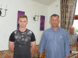

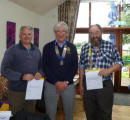

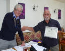


Lions handed over to our new President, Derek Williamson, on 3 July.

**The last few jobs for outgoing President Kevin**

Kevin finished out his year on a bit of a high he had the pleasure of presenting Lion Gerald Worden with a Melvin Jones Fellowship award for services to Lions & his community.

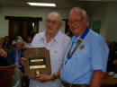

Kevin also presented Appreciation awards to

Andrew Harvey for helping the Lions clubs of Cornwall offer a diabetic screening service at the Royal Cornwall Show.

&

Sheila Worden for helping with many Lions events but her particular dedication to our annual Ten Tors walk.


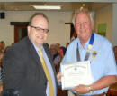

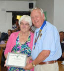


He also presented the Ten Tors walk shield for the highest sponsored team, a cheque to Cornwall Search & rescue for providing safety cover on the walk, yet another badge to Lion Dave Truran, then assisted Charlotte Whitmore presenting the Sean Whitmore Memorial shield & certificates to the winner & highly commended runners up in memory of her dad.

The Sean Whitmore Memorial Shield will be awarded each year to young individuals for services to or achievement in sport


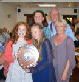

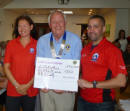

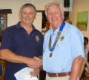


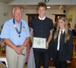

Kevin's wife Lesley presented a cheque to the Bodmin Memory Cafe on behalf of the Lions Ladies

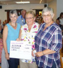
