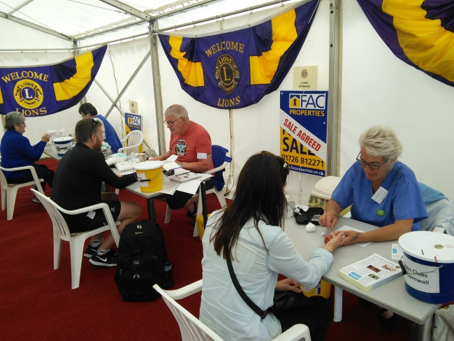
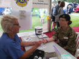
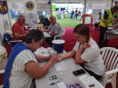
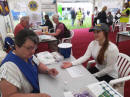
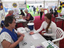
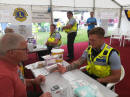
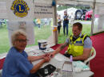
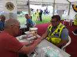

Lions organised another diabetes awareness stand at the 2018 Royal Cornwall Show. 36 Lions from Cornwall clubs and 27 qualified nurses,(some are Lions too!) combined to offer free blood sugar measurements.

1472 visitors took advantage of the service and were given appropriate advice.

Below are a few victims of the finger prick test (Sorry, people being screened for blood sugar)




