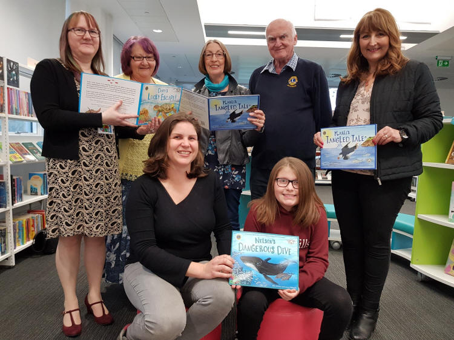
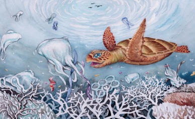
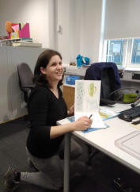

Cornwall Council issued a press release on plastics in the ocean, supported by Lions Clubs in Cornwall.





Bodmin Lions have played a vital role in reaching primary schools in Bodmin and our surrounding villages with children’s books and teaching resources on ocean plastic. The books are written by Cornish based author and illustrator team Ellie Jackson and Laura Callwood and are true stories about the problem of ocean plastic which bring the issue to the children’s level. They follow three well-loved animals as they encounter plastic bags, balloons and fishing nets and each book is written in a positive and hopeful light to inspire the next generation to tackle the issues.

Author Ellie has been on a mission to secure sponsorship for every primary school in Cornwall to each receive copies of her three children’s books and teaching resources. Through a post on social media, Ellie’s campaign was picked up on by several local individuals who kindly offered to sponsor their children’s schools and also drew the attention of Bodmin’s Lion member Jon Hancock. “Caring for our environment by teaching the next generation is key to solving this issue” said Jon, a Lions member for 30 years. “Ellie’s books are perfect for the younger members of our community to engage in this issue and with the Lions’ support we are pleased to bring this project to 9 of our local schools and our wonderful library. Bodmin Lions are actively involved in caring for the local environment and we will do everything we can to help support the children in making a difference.”

Ellie at a book signing, and a link to her website:

[[Wild Tribe Heroes](https://wildtribeheroes.com/about-us/)]([Wild Tribe Heroes](https://wildtribeheroes.com/about-us/))

