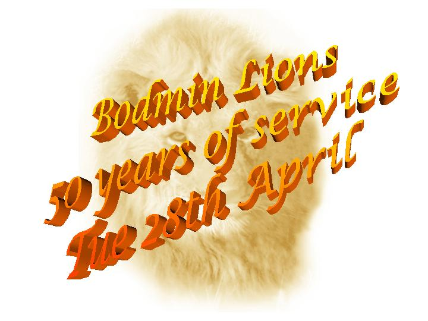
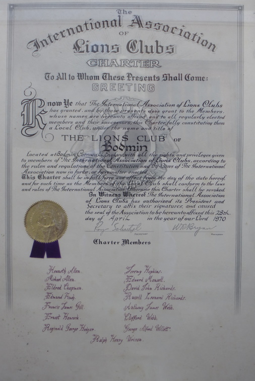

Happy 50th Birthday Lions Club of Bodmin

On the 28th April 1970 seventeen men of Bodmin met to form (Charter) the Lions Club of Bodmin.

They all put their names to the Charter document pictured below.

They then went forward to live the Lions motto of "we serve" & build the mixed gender club we have today.
