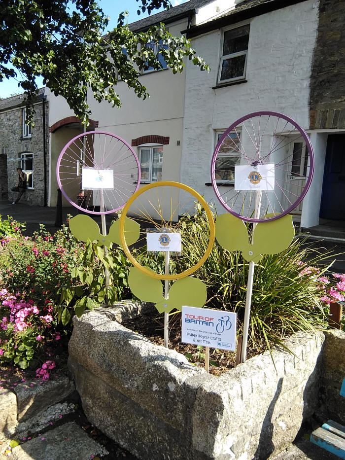

Lions are helping with the TOB cycle ride on Sun 5th Sept & will be getting our own events going again as soon as they can be done safely.

Leonides Floribunda spotted in Higher Bore Street.

Grown by Norma and the Gwel-an-Nan nurseries.

Transplanted by the Roy Whitehall garden centre.
