Monday 4th July was a landmark day for Bodmin Lions.

We welcomed into office our first Lady President.

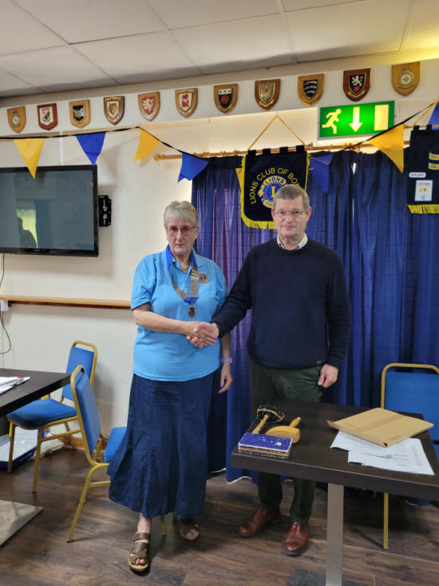

Lion president Daniel Brinson handing over the role of president to Lion Norma Fothergill . Thank you Daniel for all you have achieved as president. And congratulations to our new president Norma.

Out going president Daniel had a few words of thanks and presentations before standing down.

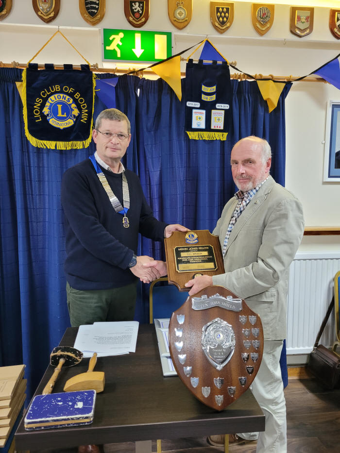

Lion Phil Wrixon receiving his well deserved Melvin Jones fellowship award and his award for 47 years as a dedicated Lion. Congratulations Phil.

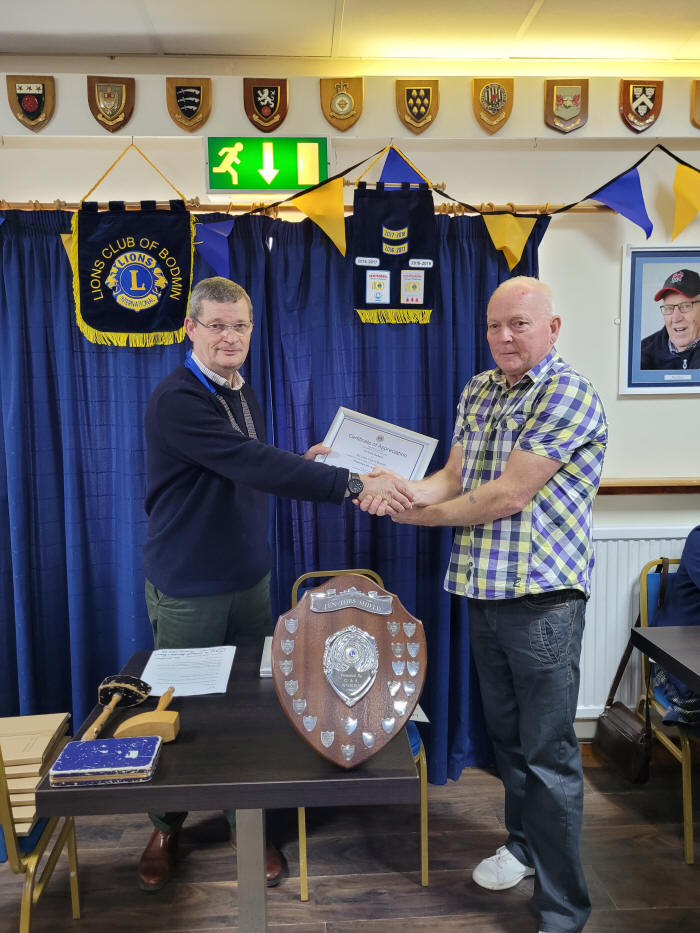

Deputy mayor Mike Barbary receiving a well earned certificate of thanks for all the assistance he gave us on our bingo evenings. Thank you Mike.

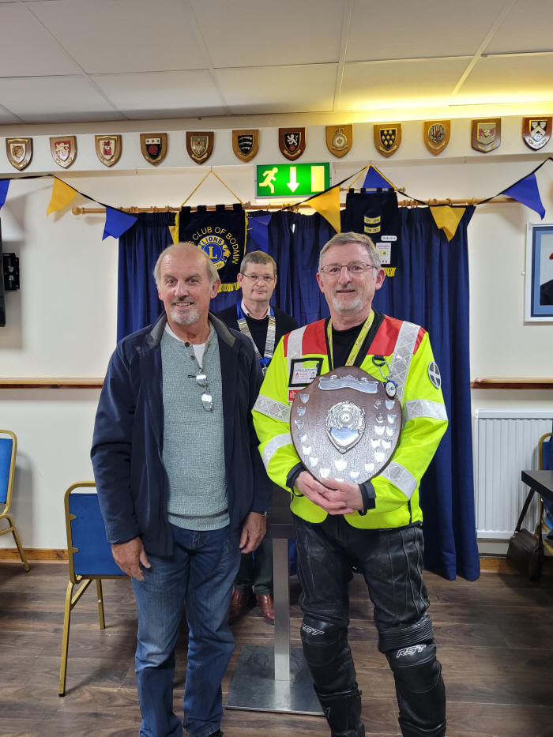

East Cornwall Search and Rescue with their well deserved award.

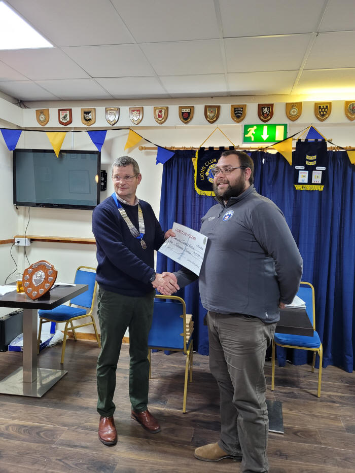

East Cornwall Search and Rescue receiving a cheque for £1000 for all the assistance they give us on our Ten Tors event.

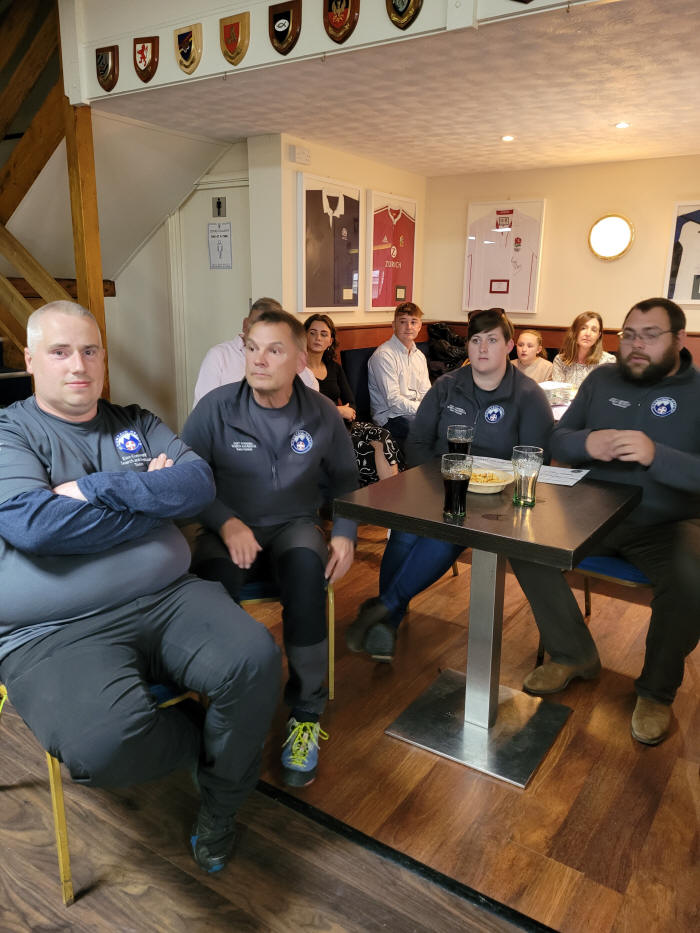

East Cornwall Search and Rescue.

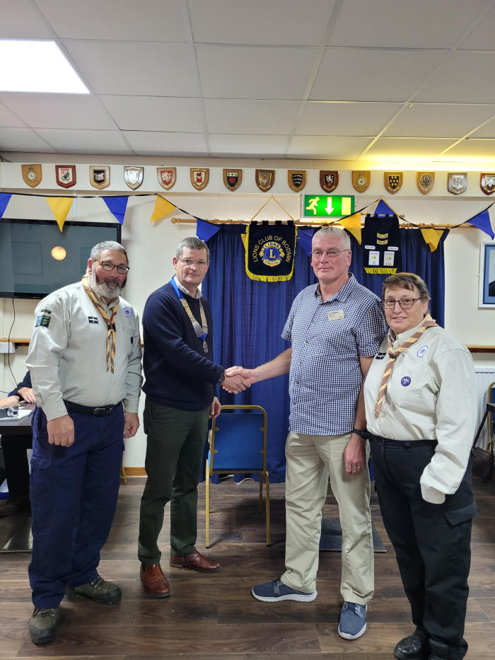

1st Castle Canyke scout group receiving £100 cheque.

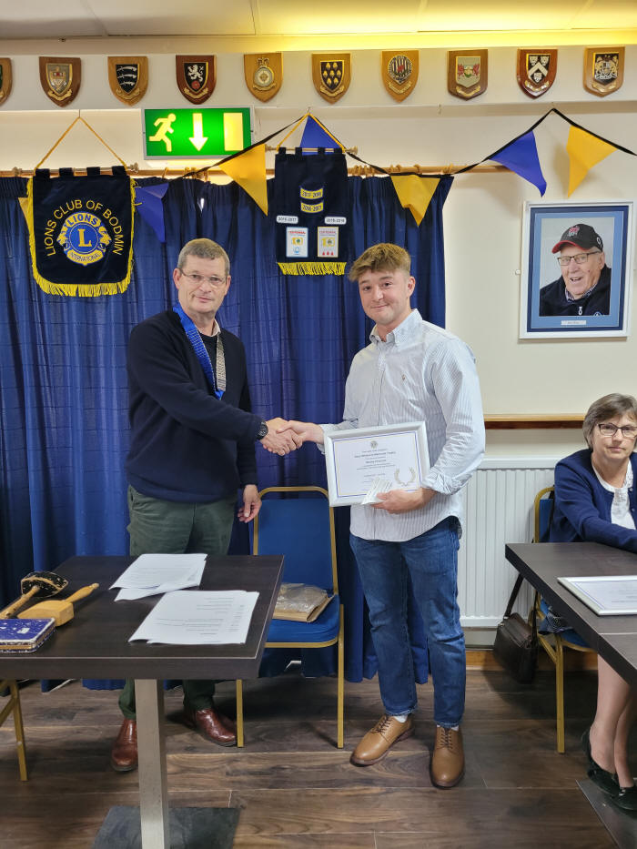

Sean Whitmore Trophy runner up Harvey Orchard receiving his cheque for £100.

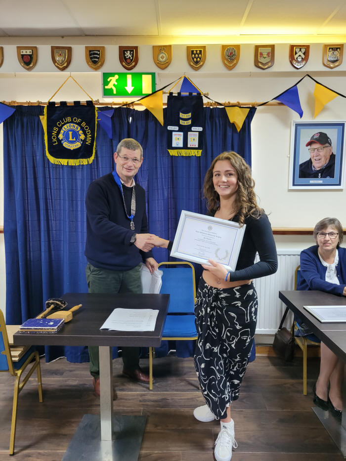

Sean Whitmore Trophy runner up Bo Rason receiving her cheque for £100.

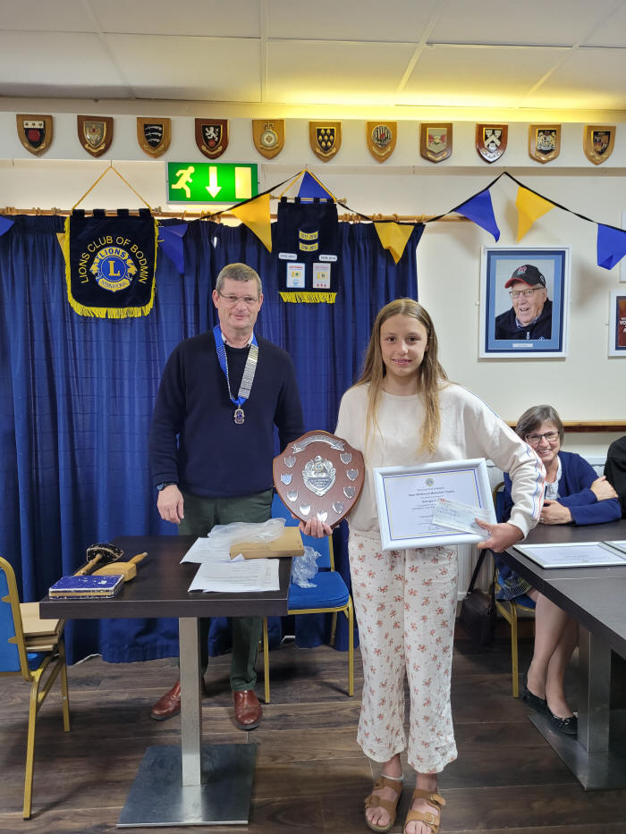

Sean Whitmore Trophy winner Georgia Clarke receiving the trophy and cheque for £300 by her sister due to ill health.

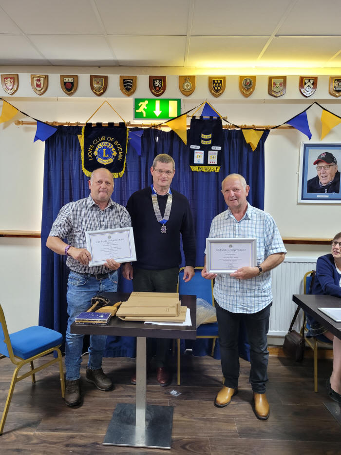

Dave and Paul Greenaway receiving their certificate of thanks for the assistance they give on our Ten Tors event.

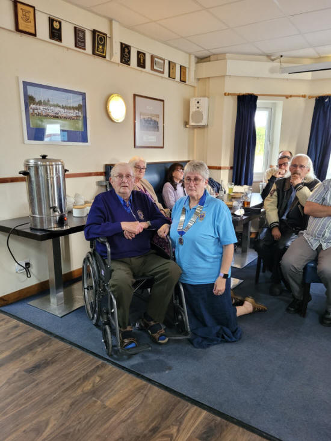

An emotional evening for Lion Gerald Worden watching his daughter become Lion president.
