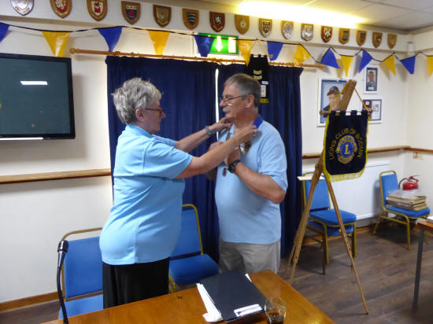

Norma handing the chain of office to Dave.

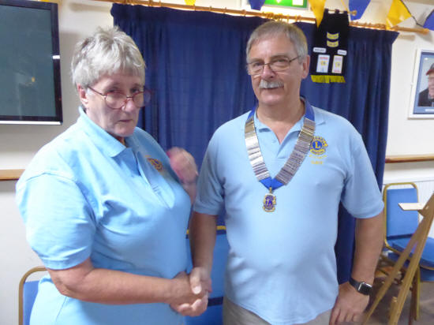

Dave's vote of thanks to Norma for all her hard work during her year as first woman Lions President of Bodmin.

**Dave then went on to present awards on behalf of the club**

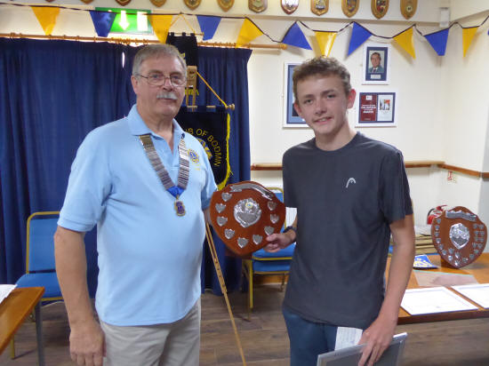

Aaron Collins, winner of the Sean Whitmore Memorial Shield and £300. (Helps with expenses) For going above and beyond in their chosen sport and service within the community.

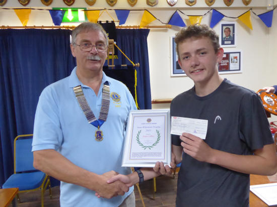

Aaron Collins, with certificate & cheque

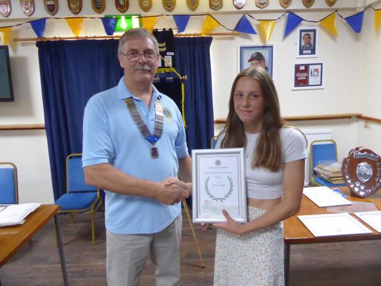

Serena Clarke, runner up of the Sean Whitmore Memorial Shield and £100.

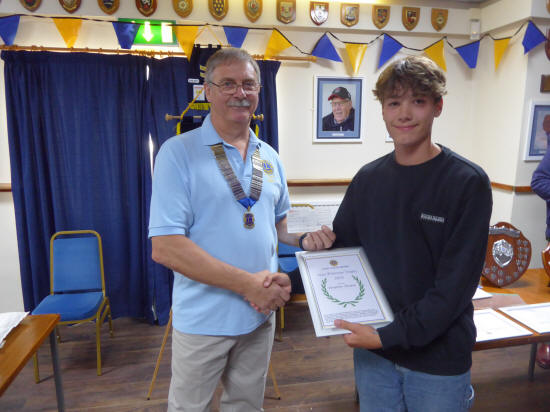

Benjamin Sleeman, runner up of the Sean Whitmore Memorial Shield and £100.

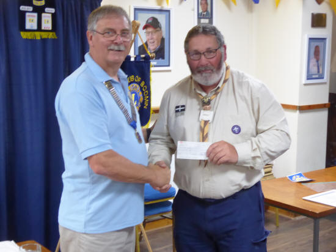

Rob Jory accepting a donation (£100) on behalf of the scouts (Helping out on 10 Tors)

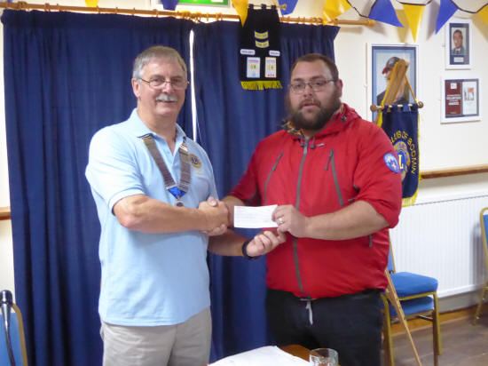

Cornwall Search and Rescue (£500) for their continuing support and for what they do helping others.

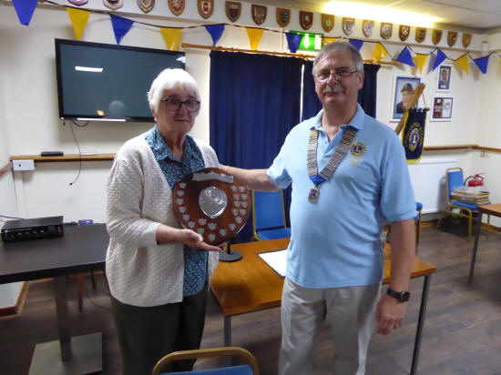

Sheila, accepting the 10 Tors Shield, on behalf of the North Cornwall Riding for Disabled Association, they raised £2167.05p this year for that charity.

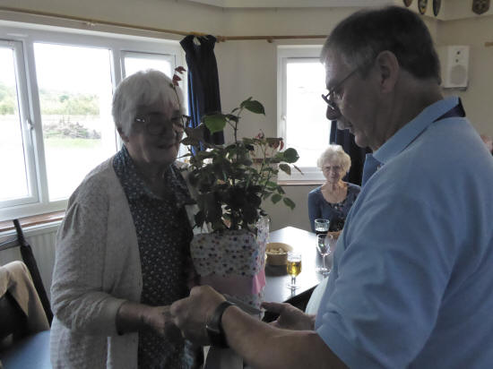

A special thank you to Sheila after 40yrs of service, who is now taking a well-deserved rest

Certificates of Appreciation went to – Steve Andrews Tyres,

Steve Hall (Hole in the Wall),

Rob Dawson and the Bodmin Camera Club for their all their support.

A special thanks went out to Justine Stephens and Bill May (MJF) for keeping our Facebook and website up to date!

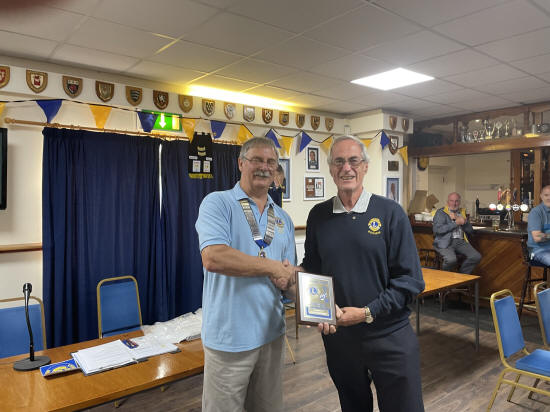

Finally, a special Presidents award went to Ron Goodgame for his service as Treasurer of the Club.
