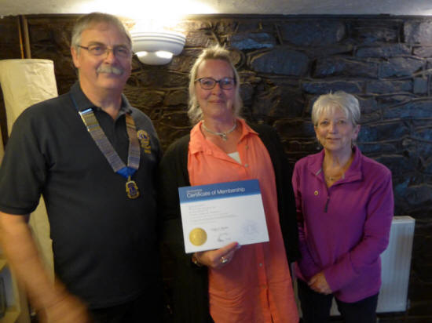
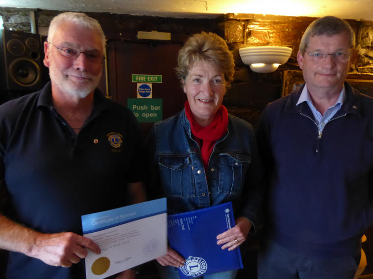
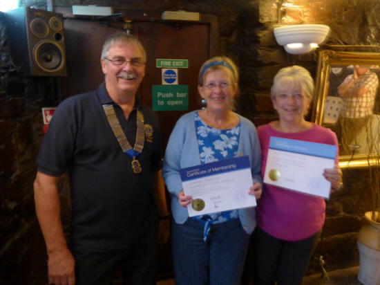
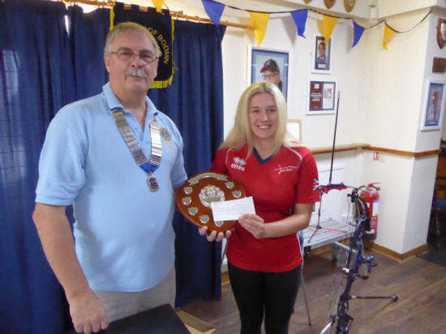
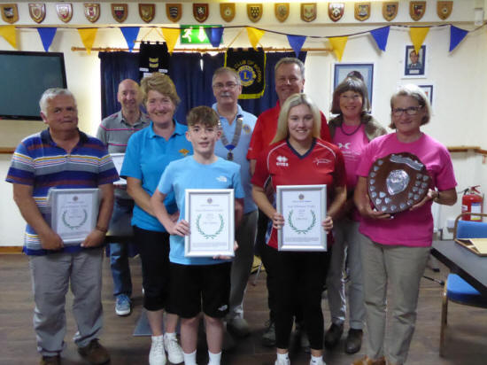

Bodmin Lions Club welcome our three new members,

They are: Rachael Williams, Sue Newman and Gilly Arnold.





Bodmin Lions Club at their handover meeting in July, Lion President, Dave Truran awarded the Sean Whitmore Shield to Chloe Scott for her achievements in her sport of archery.

The following weekend she attended the European Youth Championships 2024 in Romania representing Great Britain and returned with a GOLD MEDAL, well done Chloe.

Runners up were Alfie Chapman and Sawyer Wragg. Other awards and presentations were made to East Cornwall Search & Rescue , 1st Castle Canyke Scout Group. The Pacemakers winning team raising the most for their named Charity, Vincent Tractors and Tonkin Recovery for their help at Ten Tors.





**Ten Tors update**

The total amount raised by the Annual Bodmin Lions Ten Tors event held on May 19th 2024 amounted to £28,000, each team choosing their own charity.
