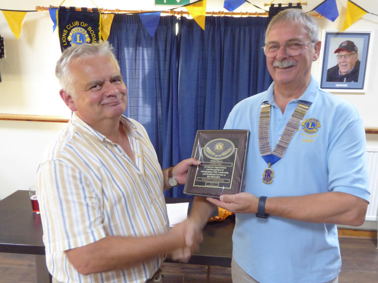
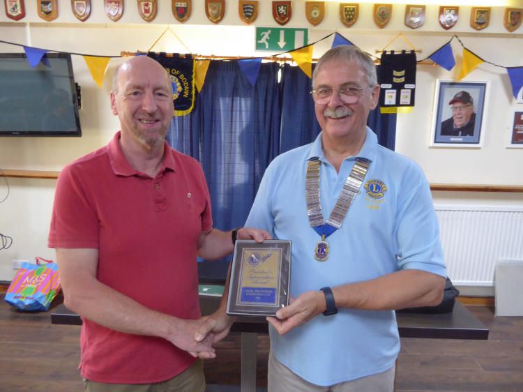
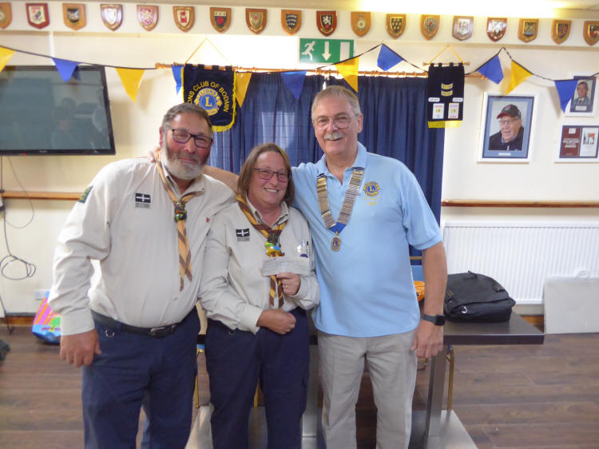
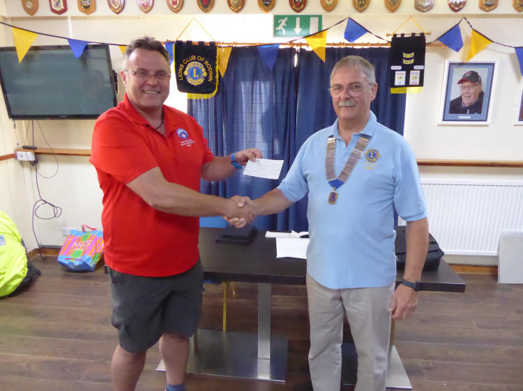
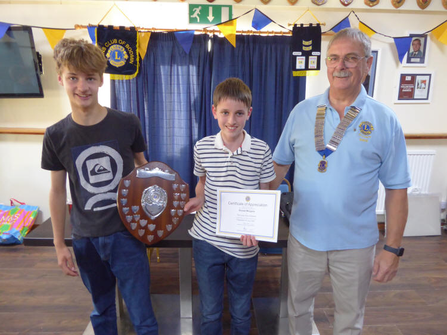
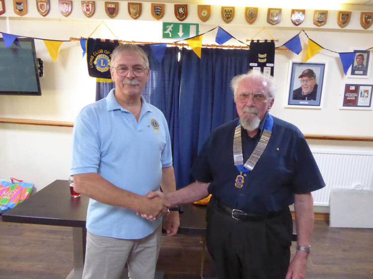

A few photos from our annual Handover evening Monday 7th July.

Photos by Lion Ron

Lion Chris Line receiving the Lions Appreciation Award & Recognition & dedicated Service as Secretary of Bodmin Lions Club

Lion Nigel Trudgeon receiving the Bodmin Lions Presidential Appreciation Award

1st Castle Canyke Scout Group receiving a cheque for £200.00

East Cornwall Search & Rescue receiving a cheque for £500.00

The Ten Tor Shield 2025 Winners

SCARD-MORGANS who raised over £2,500 for their charity Alzheimer’s Society.

And finally outgoing President Lion Dave Truran hands over to Lion Bill May for the coming year
