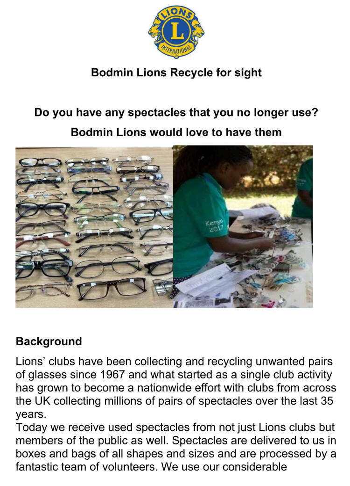
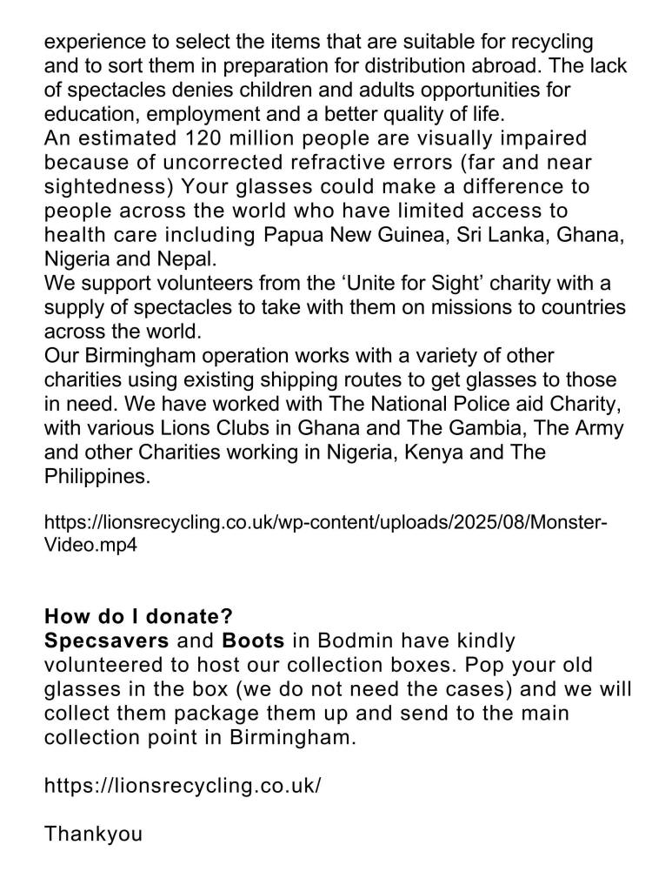





[Watch the Lions Recycle for Sight video](https://lionsrecycling.co.uk/wp-content/uploads/2025/08/Monster-Video.mp4)

Find out more at [Lions Recycle for Sight](https://lionsrecycling.co.uk/).

## Do you have spectacles you no longer use?

Bodmin Lions would love to have them. Lions clubs have been collecting and recycling unwanted glasses since 1967. What started as a single club activity is now a nationwide effort, with clubs across the UK collecting millions of pairs over the last 35 years.

An estimated 120 million people are visually impaired because of uncorrected long or short sight. Your glasses could make a difference to people with limited access to health care in countries including Papua New Guinea, Sri Lanka, Ghana, Nigeria and Nepal. Volunteers sort them in Birmingham and send them abroad with charities including Unite for Sight, the National Police Aid Charity and Lions Clubs in Ghana and The Gambia.

## How to donate

**Specsavers** and **Boots** in Bodmin have kindly agreed to host our collection boxes. Pop your old glasses in the box (we don't need the cases) and we'll package them up and send them to the main collection point in Birmingham. Thank you!
