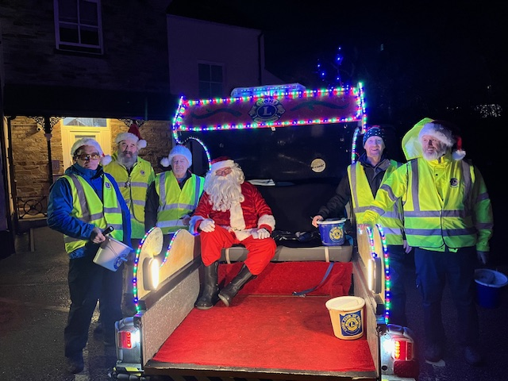
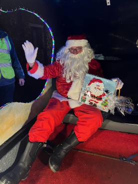
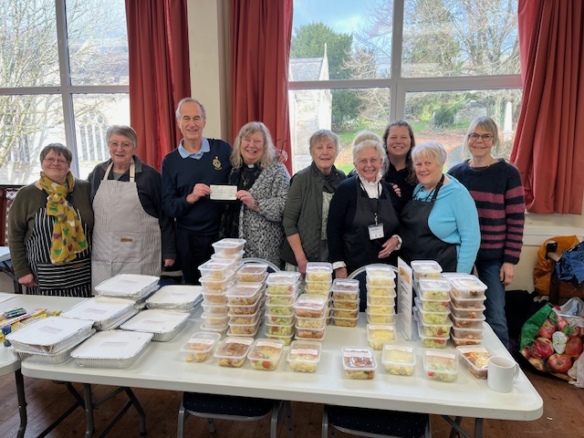
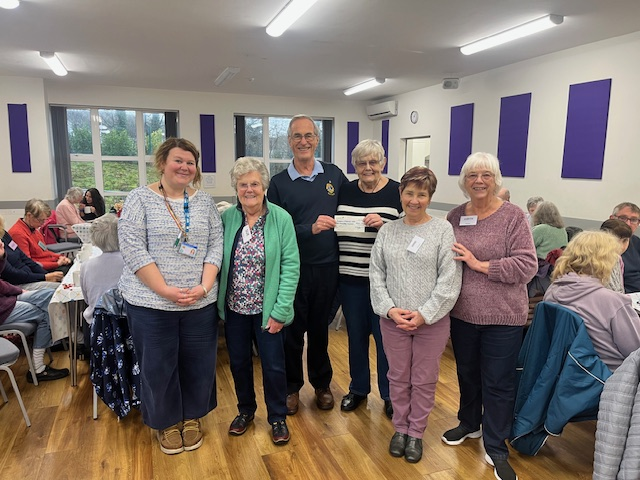
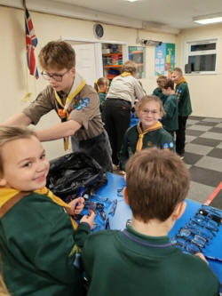
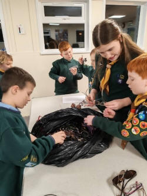
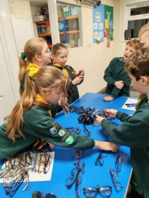

**The Lions Club of Bodmin**

We had a busy December last year when our Bodmin Lions and volunteer helpers were out with the sleigh nearly every day for the first 3 weeks. We are now focusing on sharing our success with the Community of Bodmin. We raised an amazing £5183 and can’t thank the people of Bodmin enough for their generosity





On the 9th of January our Treasurer Ron Goodgame presented £1000 to Elaine Mundy’s Pioneer Ministry which works among some of the most vulnerable individuals in the community providing vital support to people facing a wide range of challenges — including the cost-of-living crisis, loneliness, poor mental health, and low income.

Her community groups have become a lifeline for many, offering not only practical help but also friendship, connection, and a sense of belonging. These gatherings provide ongoing emotional and spiritual support, creating a safe space where people feel seen, valued, and cared for.

A community drop in where prepared meals are available

On 15th of January Ron was able to present a cheque for £500 to the local memory café supporting families and people experiencing dementia

We joined them for a cup of tea and a biscuit while they were playing a game of music Bingo. This is one of the causes that we regularly support.

The Memory Café at Lanivet Community Centre and some of its volunteers

Also this month we continue with our spectacle recycling project and have collection points in Boots Opticians and Specsavers. We enlisted an interested group of Cub Scouts from Castle Canyke to help us sort the donations. They boxed over 900 pairs of spectacles for their onward journey to Birmingham





If anyone has any old glasses that they would like to recycle then we would love to have them. Drop them off and we will pack them up for our collection centre in Birmingham who sort them further and dispatch to countries abroad with limited access to health care.

We are looking now forward to supporting the Children’s Hospice at the Pencarrow Annual Snowdrop Garden Open Day on the 8th of February

We are also now promoting the annual Sean Whitmore award for 2026. This is an annual award of **£300 plus 2 smaller awards** that are given by **Bodmin Lions Club** to young athletes or sportspeople (under 18) who are showing promise and who wish to progress in their chosen sport to a higher level.

To be considered for help and support including funding from Bodmin Lions, **we changed the process and now have an online form on our website that you can complete** and return to the Group for consideration.

If you think you might be interested in joining the Lions to in turn help your community or to volunteer with us then please email bodmin.lions@outlook.com or search for “Lions Club of Bodmin”
