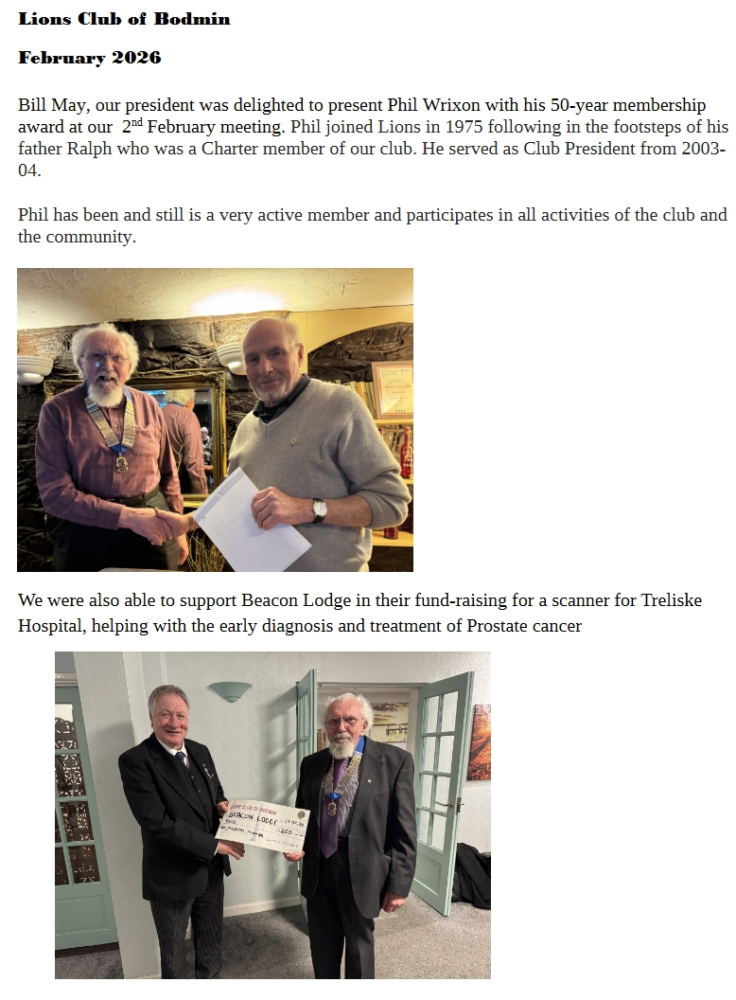

Bill May, our President, was delighted to present Phil Wrixon with his 50-year membership award at our 2nd February meeting. Phil joined Lions in 1975, following in the footsteps of his father Ralph, who was a charter member of our club. He served as Club President in 2003–04.

Phil has been, and still is, a very active member and takes part in all the activities of the club and the community.

We were also able to support Beacon Lodge in their fundraising for a scanner for Treliske Hospital, helping with the early diagnosis and treatment of prostate cancer.
