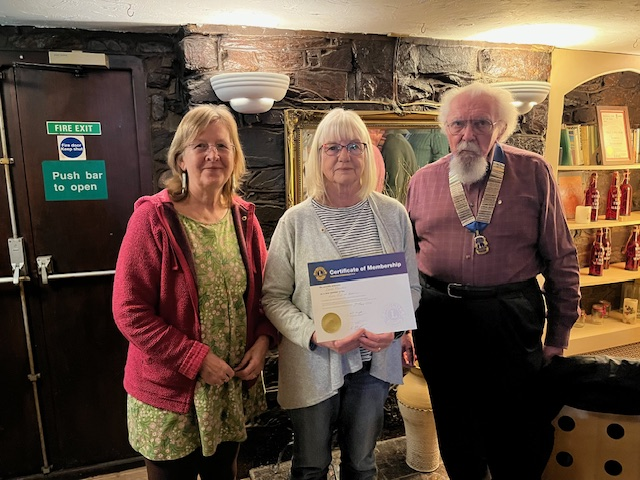
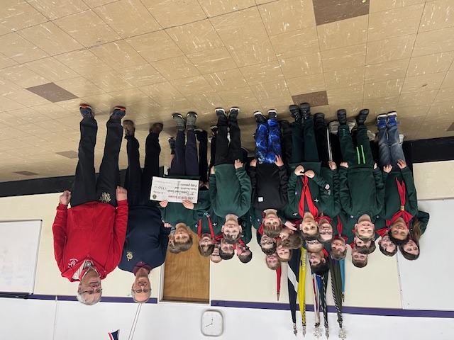
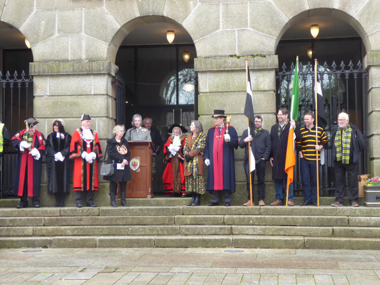
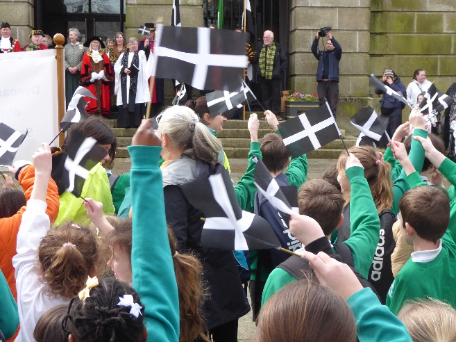
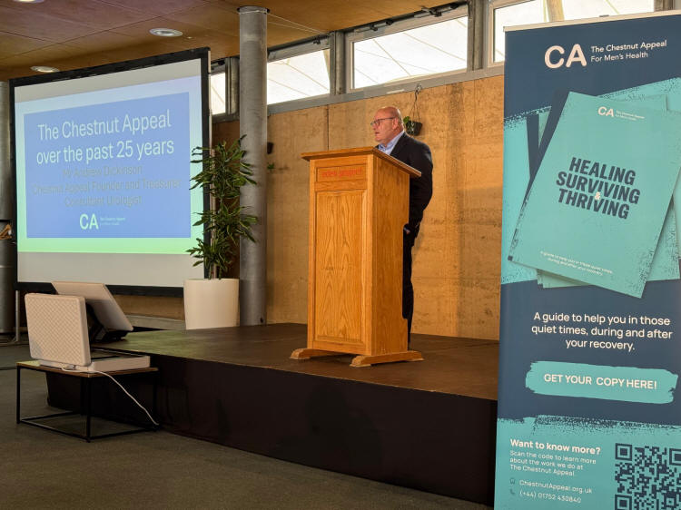
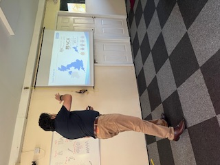
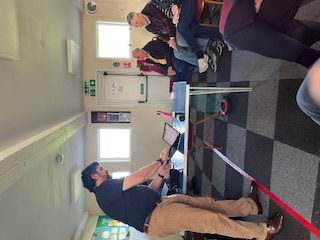

**Growing the club:** Bodmin Lions welcomed new member Deborah Vosper. She was presented with her pin and certificate by our President Bill May

**Donations:** The Club was able to support 3rd Bodmin Scout Group with a donation towards their fund-raising campaign to acquire a new electric cooker for the scout hut. Ron, our club treasurer presented the cheque to their Group Lead Volunteer at one of their cub scout evenings.

Supporting Local events: Bodmin St Piran's Day Parade 5th March 2026

Bodmin Lions Club has supported the St Piran's Day Parade for 15 years and is a member of the Bodmin St Piran's Day Committee.

This year ten schools in the Bodmin and District area took part in this year's St Piran's Day Parade. It is held each year on the 5th of March unless the day falls on a weekend, when it will take place on the nearest weekday because of the schools being closed.

This year over 260 young children from local primary schools attended, parading down Bodmin Fore Street from the Old Library to Mount Folly led by the Mayor of Bodmin. Speeches were made and then the children danced together in formation. Afterwards the procession moved on to St Petroc's Church the day ended with the whole congregation singing a rousing rendition of the "Cornish Anthem" Trelawny. After their performances the children tucked in to a welcome Cornish Pasty provided by the Committee.





**Invitations:** Representatives from the club were invited to attend an information session by the Chestnut Appeal for Men’s Health. They were launching the Survivorship Pack at the Eden project on the 9th of March. The information has been shared with all club members

**Other activities:** The club organised a talk on Cyber security from Devon and Cornwall Police on the 18th, everyone came away with many helpful suggestions to make themselves and their families safer online. They would be happy to talk to other groups and can be contacted via Devon and Cornwall Police Cyber Security Unit





Our annual Sean Whitmore Award is gaining momentum as we invite applications from inspirational young people for this award to support them in their sporting journeys.

Bookings have also started coming in for the Club annual Bodmin 10 Tors event organised and run by Bodmin Lions. Teams of up to 4 people walk 13 miles across the Tors on Bodmin Moor. This is keeping some of our members very busy.
