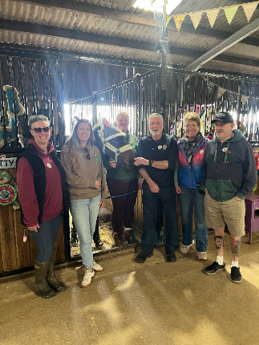
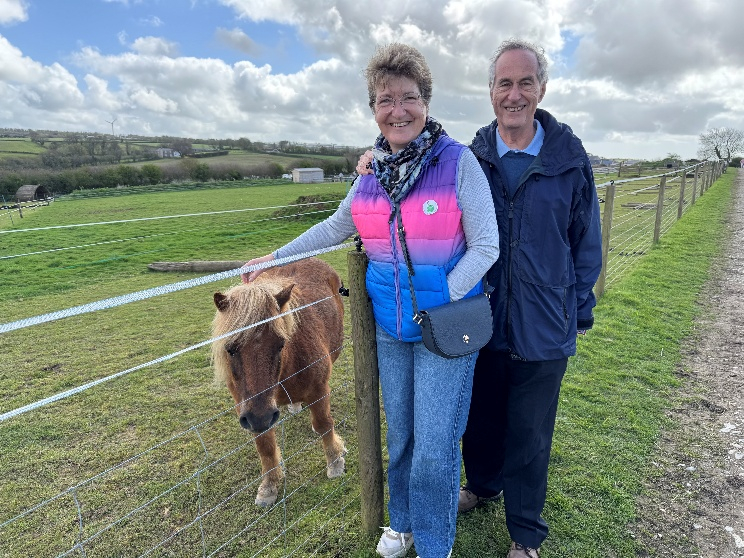
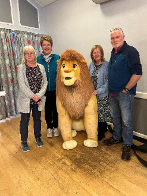
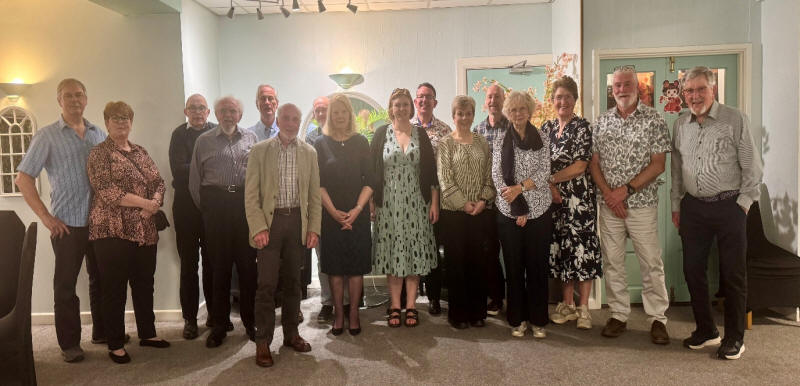

**Bodmin Lions news round up**

We have been out and about this month

A visit to Hugs to explore how we can help them develop their work supporting young people and adults with a range of additional needs.

They do this alongside rescuing and re-homing horses and ponies.





We helped as marshals for the annual Bodmin Beast Marathon which took the runners though Lanhydrock and the surrounding villages.

Four club members attended the spring forum which we all found informative. We also enjoyed meeting fellow Lions across the District.

We were able to support one of our local explorer scout groups with a request for tents needed for an international camp. We pledged the funding for 2 of the lightweight tents they needed.

We finished the month with our informal charter dinner at the local Westbury Hotel.

