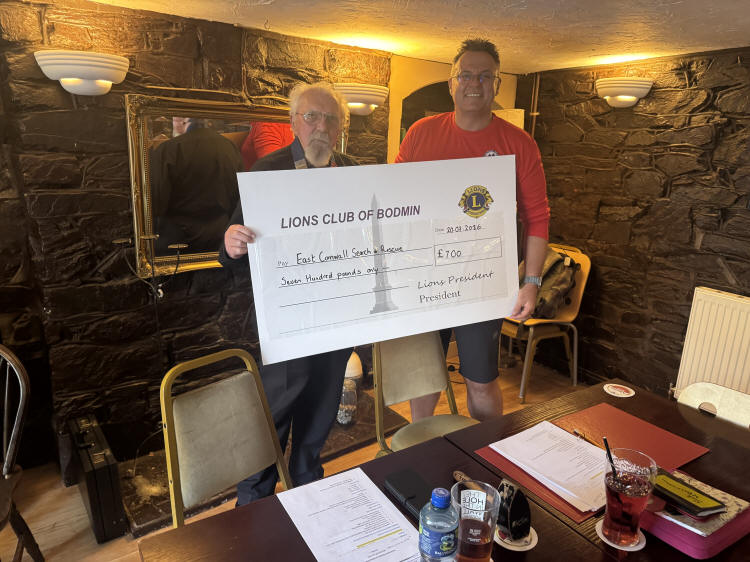
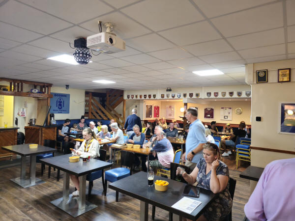
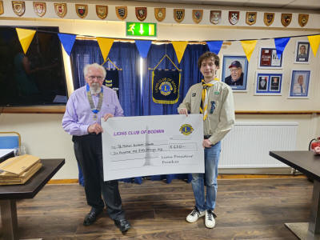
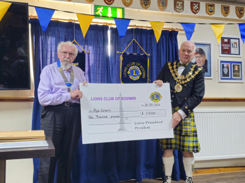
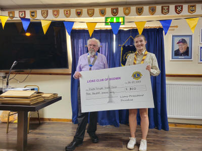
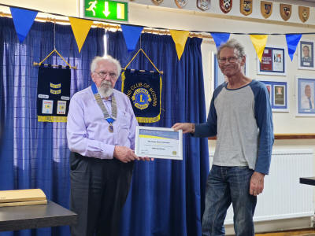
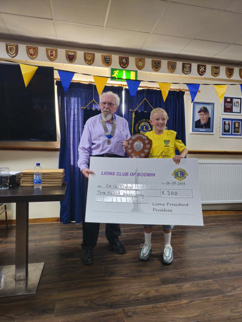
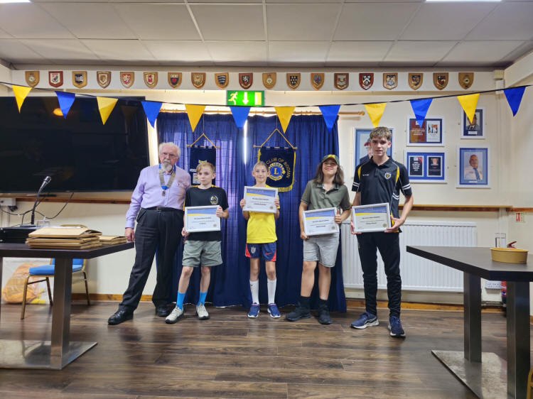
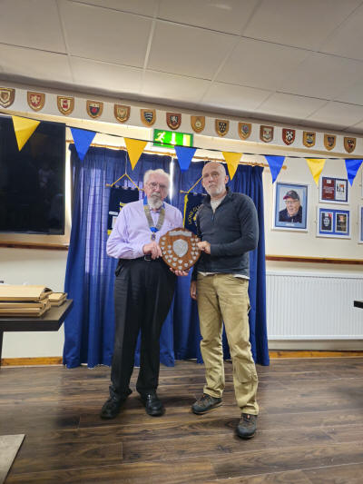
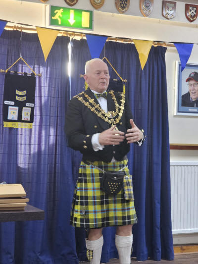

At our meeting on Monday we presented East Cornwall Search & Rescue Team with a cheque for providing help and advice at our Ten Tors event.

It's a few days late but here are some photos taken at Lions handover night on Monday 6th July at Bodmin Rugby Club.

This night marks the end of one Lion Year and the start of the next.

We say thank you to people who have helped us, we present a few awards and cheques then make any changes of club officers.





We presented cheques to Castle Canyke Scouts, St Mabyn Scouts, Bodmin Age Concern.

We presented a cheque and shield to the winner of the Sean Whitmore trophy, a trophy presented for achievement and encouragement in sport for young people.

This year we had 4 runners up for the trophy they each received a certificate and a smaller cheque.

We then presented a shield to the team that raised the most money for their charity at our Ten Tors walk on Bodmin Moor, they raised over £3,000.

Finally Bodmin Mayor Councillor Mike Barbery thanked the Lions for their work and help with town events.
